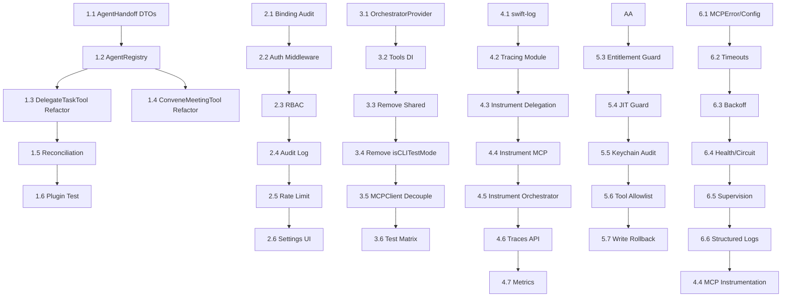

# ApexAgent Implementation Plan: Closing the Biggest Gaps

**Authored:** June 2026  
**Status:** Ready for Execution  
**Scope:** 6 major workstreams addressing structural, security, observability, and enterprise-readiness gaps

---

## Executive Summary

This plan addresses the 6 critical gaps identified in the June 2026 audit. Each workstream is decomposed into concrete, verifiable tasks following the **Execute → Verify → Report** loop. No task is marked complete until code compiles, tests pass, and the change is verified against acceptance criteria.

---

## Workstream 1: Generic Multi-Agent Architecture (Hardcoded → Plugin-Based)

### Problem
- `DelegateTaskTool` and `ConveneMeetingTool` hardcode 7 `AgentType` cases across ~400 lines of duplicated `switch` logic
- No typed handoff contract between Supervisor and Specialist agents
- No reconciliation when agents disagree
- Works in tests but is brittle and unauditable

### Target State
- [ ] Agent definitions are data-driven (JSON/YAML registry), not code-driven
- [ ] `AgentHandoff` protocol defines typed transfer objects (`TaskContext`, `TaskResult`, `Disagreement`)
- [ ] `AgentRegistry` loads agent profiles from disk, supports 3rd-party plugins
- [ ] `ConveneMeetingTool` uses structured debate protocol with explicit consensus/rejection tracking
- [ ] All subprocess agents emit trace spans; Supervisor can replay a run

### Tasks

| ID | Task | Acceptance Criteria | Est. Effort |
|----|------|---------------------|-------------|
| 1.1 | **Define `AgentHandoff` protocol & DTOs**<br>Create `AgentHandoff.swift` with `TaskContext`, `TaskResult`, `AgentDisagreement`, `ConsensusReport` structs. Use `@Generable` for LLM serialization. | Compiles; unit test serializes/deserializes round-trip | 1 day |
| 1.2 | **Build `AgentRegistry`**<br>Load agent definitions from `~/.apex/agents/*.json` (name, systemPrompt, allowedTools, modelPreference). Fallback to built-in defaults. | `AgentRegistry.shared.allAgents` returns 7 built-ins + any user files | 1 day |
| 1.3 | **Refactor `DelegateTaskTool`**<br>Replace massive `switch` with `AgentRegistry.resolve(type).createSession(...)`. Pass `TaskContext` (topic, history, constraints). Return typed `TaskResult`. | No `switch` on `AgentType`; 100+ lines removed; tests pass | 2 days |
| 1.4 | **Refactor `ConveneMeetingTool`**<br>Implement structured debate: Round 1 (positions), Round 2 (rebuttals), Round 3 (consensus vote). Emit `ConsensusReport` with majority/minority positions. | Meeting produces `ConsensusReport`; dissent tracked; no hardcoded rounds | 2 days |
| 1.5 | **Add reconciliation primitive**<br>`AgentOrchestrator.resolveDisagreement(_ disagreement: AgentDisagreement) async -> Resolution` — escalates to Supervisor or runs tie-breaker agent. | Disagreements logged; resolution recorded in trace | 1 day |
| 1.6 | **Plugin load test**<br>Drop a custom agent JSON in `~/.apex/agents/custom.json`; verify it appears in `DelegateTaskTool` completions and works end-to-end. | Custom agent invokable via `delegate_task` | 0.5 days |

### Verification
```bash
# After each task:
swift build
swift test --filter "DelegateTaskTool\|ConveneMeetingTool\|AgentRegistry"
# Manual: Run Apex, delegate to "researcher", verify typed TaskResult returned
```

---

## Workstream 2: CollaborativeServer Hardening (LAN Exposure → Zero-Trust)

### Problem
- Binds to interface (currently `127.0.0.1` but configurable) with **no authentication**
- Serves `/api/state` (full conversation + plan + tool events), `/dashboard` (HTML + WebSocket), `/api/screen` (live screen captures)
- No authorization, no TLS, no audit log of who accessed what

### Target State
- [ ] Server binds localhost-only by default; opt-in for LAN requires explicit user consent + auth
- [ ] Token-based auth (Bearer) or mutual TLS for any non-localhost binding
- [ ] Per-endpoint RBAC: `read:state`, `read:screen`, `write:command`
- [ ] Access audit log (who, when, what endpoint, decision)
- [ ] Rate limiting + request size limits

### Tasks

| ID | Task | Acceptance Criteria | Est. Effort |
|----|------|---------------------|-------------|
| 2.1 | **Audit current binding**<br>Confirm `NWParameters.requiredLocalEndpoint = 127.0.0.1` is hardcoded (not configurable to `0.0.0.0` without opt-in). | Code review: no path to `0.0.0.0` without explicit flag | 0.5 days |
| 2.2 | **Add auth middleware**<br>`CollaborativeServer.Authenticator` protocol with `validate(request) -> AuthContext?`. Implement `BearerTokenAuth` (configurable token) and `MTLSAuth` (cert pinning). | Requests without valid auth → 401; valid token → proceeds | 1.5 days |
| 2.3 | **RBAC policy engine**<br>Define `Permission` enum; map endpoints to required permissions. Store policy in `CollaborativeServer.policy` (Codable). | `/api/state` requires `read:state`; `/api/screen` requires `read:screen` | 1 day |
| 2.4 | **Access audit log**<br>Append JSONL to `~/Library/Logs/ApexAgent/collab-access.log` with `{timestamp, clientIP, endpoint, authContext, decision}`. | Log entries written on every request; rotatable | 0.5 days |
| 2.5 | **Rate limiting & hardening**<br>Token bucket per client IP (10 req/s burst 20). Max request body 1MB. TLS cert generation helper for LAN mode. | `wrk -t4 -c100 -d10s` shows 429s under load; TLS cert auto-generated | 1 day |
| 2.6 | **Settings UI**<br>Add "Collaborative Server" section in SettingsView: enable/disable, port, auth mode (none/local/token/mtls), token display, view audit log. | User can toggle LAN mode only after creating token; log viewable in-app | 1 day |

### Verification
```bash
# Unit tests
swift test --filter "CollaborativeServer"

# Integration: curl with/without token
curl -H "Authorization: Bearer $TOKEN" http://127.0.0.1:1337/api/state  # 200
curl http://127.0.0.1:1337/api/state  # 401

# Audit log check
tail -f ~/Library/Logs/ApexAgent/collab-access.log
```

---

## Workstream 3: AgentOrchestrator Singleton → Dependency Injection

### Problem
- `AgentOrchestrator.shared` static property used by 20+ tools and MCPClient
- Makes testing hard (global state bleed), lifecycle management fragile
- Race conditions: tools access `shared` before init or after teardown
- `isCLITestMode` static flag is a code smell

### Target State
- [ ] `AgentOrchestrator` is a regular class instantiated once at app launch
- [ ] Tools receive orchestrator via initializer (protocol `ToolContextProvider`)
- [ ] `AgentOrchestrator.shared` removed; replaced with `@Environment` / DI container
- [ ] Test doubles can inject mock orchestrator without global mutation

### Tasks

| ID | Task | Acceptance Criteria | Est. Effort |
|----|------|---------------------|-------------|
| 3.1 | **Define `OrchestratorProvider` protocol**<br>`protocol OrchestratorProvider { var orchestrator: AgentOrchestrator { get } }`<br>Conform `AppDelegate`/`App` entry point. | Compiles; single source of truth | 0.5 days |
| 3.2 | **Update all Tools to accept provider**<br>Change `Tool` conformers: `init(provider: OrchestratorProvider)` stored property. Update `AgentOrchestrator.allTools` factory. | No tool accesses `AgentOrchestrator.shared` directly | 2 days |
| 3.3 | **Remove `AgentOrchestrator.shared` static**<br>Delete line 893 + all usages. Replace with `provider.orchestrator`. | `grep -r "AgentOrchestrator.shared" --include="*.swift" Sources` returns 0 | 1 day |
| 3.4 | **Eliminate `isCLITestMode` static**<br>Replace with `ProcessInfo.processInfo.environment["APEX_TEST_MODE"] == "1"` or test-only DI override. | No static test flags; tests inject mock orchestrator | 0.5 days |
| 3.5 | **Fix MCPClient coupling**<br>`MCPClient` calls `AgentOrchestrator.shared?.logToolEnd(...)`. Pass `ToolEventLogger` protocol instead. | MCPClient compiles without AgentOrchestrator import | 0.5 days |
| 3.6 | **Test matrix**<br>Run full test suite; add `AgentOrchestratorTests` with mock provider verifying isolation. | All tests pass; no global state leaks between tests | 1 day |

### Verification
```bash
swift test
# Verify no "shared" references:
rg "AgentOrchestrator\.shared" ApexAgent/ --include="*.swift"
# Should return empty
```

---

## Workstream 4: Observability (Print → Structured Tracing)

### Problem
- `MCPClient` logs stderr via `print()` directly to console
- No trace IDs, spans, latency metrics, per-agent timing
- Impossible to debug multi-agent runs in production
- No correlation between Supervisor decisions and Specialist outputs

### Target State
- [ ] **Structured logging**: `Logger` (swift-log) with JSON output, log levels
- [ ] **Distributed tracing**: W3C `traceparent` headers propagated across agent boundaries
- [ ] **Spans** for: tool calls, LLM streaming, agent delegation, meeting rounds, MCP requests
- [ ] **Metrics**: Prometheus `/metrics` endpoint (optional) or in-memory counters
- [ ] **Dashboard integration**: CollaborativeServer `/api/traces` returns recent traces

### Tasks

| ID | Task | Acceptance Criteria | Est. Effort |
|----|------|---------------------|-------------|
| 4.1 | **Add swift-log + swift-metrics**<br>Package.swift: add `apple/swift-log`, `apple/swift-metrics`, `swift-distributed-tracing`. | Dependencies resolve; `Logger(label:)` works | 0.5 days |
| 4.2 | **Create `Tracing` module**<br>`Tracer`, `Span`, `SpanContext`, `Baggage` wrappers. `Tracer.shared` (or DI) emits `SpanData` to in-memory ring buffer + JSONL file. | `Tracer.startSpan("delegate_task")` produces trace with ID, parent, timing | 1.5 days |
| 4.3 | **Instrument `DelegateTaskTool` & `ConveneMeetingTool`**<br>Wrap `call(arguments:)` in span. Propagate `traceparent` to sub-agent session via `Transcript` metadata. Child spans for each round/turn. | Traces show supervisor → specialist hierarchy with timings | 1.5 days |
| 4.4 | **Instrument `MCPClient`**<br>Replace `print(stderr)` with structured log events. Add spans for `sendRequest`, `processStdout`, `processStderr`. Include `mcp.server`, `mcp.method`, `duration_ms`. | MCP calls visible in trace; errors have context | 1 day |
| 4.5 | **Instrument `AgentOrchestrator` main loop**<br>Spans for `sendMessage`, `runMessageGeneration`, `tool execution`, `context compaction`. | End-to-end user turn latency broken down | 1 day |
| 4.6 | **Expose traces via API**<br>`CollaborativeServer` adds `/api/traces?limit=50` returning recent `SpanData` JSON. Dashboard "Traces" panel. | Browser can fetch and render flamegraph/timeline | 1 day |
| 4.7 | **Metrics counters**<br>Counter: `agent.turns.total`, `agent.tools.invoked`, `agent.errors`, `mcp.requests`, `mcp.latency_ms` (histogram). | `curl /metrics` shows counters incrementing | 0.5 days |

### Verification
```bash
# Run a multi-agent task
# Check trace output:
cat ~/Library/Logs/ApexAgent/traces.jsonl | jq '.[] | {name, duration_ms, attributes}'

# Dashboard: open http://127.0.0.1:1337/ → Traces tab shows flamegraph
```

---

## Workstream 5: Security Hardening (Personal → Enterprise-Grade)

### Problem
- **No App Sandbox** (`com.apple.security.app-sandbox: false`)
- **No notarization/hardened-runtime workflow confirmed**
- `com.apple.security.cs.allow-jit: false` (correct for now, but need guardrail)
- API keys in Keychain (good) but **no audit log export**, **no per-tool allowlist**, **no rollback for writes**

### Target State
- [ ] **App Sandbox enabled** with minimal entitlements
- [ ] **Hardened Runtime** + notarization CI pipeline (GitHub Actions)
- [ ] **Entitlement drift detection**: CI fails if entitlements change without review
- [ ] **Keychain access audit log**: every read/write logged (key, timestamp, caller)
- [ ] **Tool allowlist**: per-tool enable/disable in Settings; dangerous tools require explicit opt-in
- [ ] **Write rollback**: `write_file`/`delete_file` create snapshot; `undo_last_write` tool

### Tasks

| ID | Task | Acceptance Criteria | Est. Effort |
|----|------|---------------------|-------------|
| 5.1 | **Enable App Sandbox**<br>Flip `com.apple.security.app-sandbox` to `true`. Add minimal entitlements: `network.client`, `files.user-selected.read-write`, `files.downloads.read-write`, `automation.apple-events`. Remove `network.server` (CollaborativeServer moves to separate helper or uses XPC). | `codesign -d --entitlements :- build/ApexAgent.app` shows sandbox=true | 2 days |
| 5.3 | **Entitlement drift guard**<br>Script `scripts/check_entitlements.sh` comparing `ApexAgent.entitlements` to committed baseline. CI runs on PR. | PR changing entitlements fails with diff | 0.5 days |
| 5.4 | **JIT guardrail**<br>Add build-time assertion: `#if ENABLE_JIT; #error "JIT not allowed"; #endif`. Document process for future JIT needs (WebAssembly, etc.). | Build fails if `com.apple.security.cs.allow-jit` accidentally enabled | 0.5 days |
| 5.5 | **Keychain audit log**<br>Wrap `KeychainManager.get/set` to append to `~/Library/Logs/ApexAgent/keychain-audit.log` (key, operation, success, caller stack). | Log entries for every API key access | 0.5 days |
| 5.6 | **Per-tool allowlist**<br>SettingsView: "Tool Permissions" table (Tool name | Enabled | Requires Confirmation). Persist to SwiftData `ToolPermissions`. `AgentOrchestrator.shouldConfirmTool` consults this. | User can disable `run_shell_command`; tool returns "disabled by policy" | 1.5 days |
| 5.7 | **Write rollback / snapshots**<br>`FileWriteTool`/`DeleteFileTool` create `.apex/snapshots/<file>.<timestamp>.bak` before write. New `RollbackTool` lists recent snapshots and restores. | `undo_last_write` restores previous version; snapshot dir auto-pruned (keep 50) | 1.5 days |

### Verification
```bash
# Sandbox check
codesign -d --entitlements :- build/ApexAgent.app | grep app-sandbox

xcrun notarytool info build/ApexAgent.app --keychain-profile "notary"

# Tool permissions
# Disable shell tool in Settings → ask agent to run command → should be denied
```

---

## Workstream 6: MCP Resilience (Basic → Production-Grade)

### Problem
- MCPClient has **no timeouts**, **no backoff**, **no health checks**
- Process crashes silently; no auto-restart
- Stderr goes to print; no structured error classification
- June 2026 baseline: timeouts, exponential backoff, health endpoints, circuit breaker

### Target State
- [ ] **Connect/Request timeouts** configurable per server
- [ ] **Exponential backoff** on connection failure (max 5 retries, cap 30s)
- [ ] **Health check** (`ping`/`tools/list` on startup + periodic)
- [ ] **Circuit breaker**: after N failures, stop retrying; manual reset
- [ ] **Structured errors**: `MCPError` enum (ConnectionFailed, Timeout, ProtocolError, ToolError)
- [ ] **Process supervision**: auto-restart on crash; max restart rate

### Tasks

| ID | Task | Acceptance Criteria | Est. Effort |
|----|------|---------------------|-------------|
| 6.1 | **Define `MCPError` & `MCPClientConfig`**<br>`struct MCPClientConfig { var connectTimeout: Duration = .seconds(10); var requestTimeout: Duration = .seconds(60); var maxRetries: Int = 5; var healthCheckInterval: Duration = .seconds(30) }` | Config drives all timeouts/retries | 0.5 days |
| 6.2 | **Add timeout to `sendRequest`**<br>`withTaskGroup` + `Task.sleep` for request timeout. Cancel continuation on timeout. | Request exceeding timeout → `MCPError.Timeout` | 1 day |
| 6.3 | **Implement exponential backoff**<br>`start()` retries with `min(2^attempt * 0.5s, 30s)` + jitter. Log each attempt. | 5 retries over ~60s before giving up | 1 day |
| 6.4 | **Health check + circuit breaker**<br>On `start()`: `tools/list` must succeed. Periodic health check task. After 3 consecutive failures → `CircuitOpen` state; reject requests until manual `reset()`. | Health check runs; circuit opens/closes correctly | 1.5 days |
| 6.5 | **Process supervision**<br>`MCPClient` monitors `process.terminationStatus`. On unexpected exit → log, backoff, restart (max 3/min). Emit `MCPProcessRestarted` event. | Kill MCP process → client restarts it; metrics increment | 1 day |
| 6.6 | **Structured logging integration**<br>Replace all `print` in MCPClient with `Logger` (from Workstream 4). Include `serverName`, `traceId`, `spanId`. | MCP logs appear in trace with correlation IDs | 0.5 days |

### Verification
```bash
# Kill MCP server process mid-request
# Verify: client reconnects, request retries, eventual success or clean error

# Network partition simulation
# Verify: circuit breaker opens after 3 failures, rejects fast, manual reset works

# Timeout test
# Slow MCP server (sleep 120s) → request times out at 60s with MCPError.Timeout
```

---

## Cross-Cutting: Test Infrastructure & CI

| ID | Task | Acceptance Criteria |
|----|------|---------------------|
| CI.2 | **Integration test harness**<br>`ApexAgentIntegrationTests` target with real `AgentOrchestrator` (no mocks) | Tests exercise full multi-agent flows |
| CI.3 | **Snapshot testing for traces**<br>Golden JSONL files for known workflows; diff on change | `swift test` fails if trace shape changes unexpectedly |

---

## Execution Order & Dependencies



**Recommended sprint order:**
1. **Workstream 3 (DI)** — unblocks clean testing for all others
2. **Workstream 1 (Generic Multi-Agent)** — core product value
3. **Workstream 4 (Observability)** — needed to debug 1 & 2
4. **Workstream 2 (Server Hardening)** — security baseline
5. **Workstream 6 (MCP Resilience)** — reliability
6. **Workstream 5 (Security Hardening)** — release gate

---

## Definition of Done (Per Task)

A task is **only** marked complete when:
1. ✅ Code compiles (`swift build -c release`)
2. ✅ All existing tests pass (`swift test`)
3. ✅ New unit/integration tests added and passing
4. ✅ Manual verification against acceptance criteria documented
5. ✅ No `print()` debugging left in production code paths
6. ✅ No `// TODO:` or `// FIXME:` without linked GitHub issue

---

## Risk Register

| Risk | Likelihood | Impact | Mitigation |
|------|------------|--------|------------|
| App Sandbox breaks file access (PTY, screenshots, automation) | High | High | Phase 5.1: test each entitlement incrementally; fallback to user-selected directories |
| DI refactor breaks SwiftUI `@Observable` bindings | Medium | High | Keep `AgentOrchestrator` `@Observable`; pass provider via `@Environment` |
| Tracing overhead affects LLM streaming latency | Low | Medium | Benchmark; use sampling (100% for errors, 10% for normal) |
| MCP process supervision conflicts with user's own MCP managers | Low | Medium | Opt-in supervision; detect existing process on port |

---

## Estimated Timeline

| Workstream | Effort | Parallelizable? |
|------------|--------|-----------------|
| 1. Generic Multi-Agent | 8 days | Yes (after DI) |
| 2. Server Hardening | 5.5 days | Yes |
| 3. DI Refactor | 5.5 days | **First** (blocks others) |
| 4. Observability | 7 days | Yes (after DI) |
| 5. Security Hardening | 7.5 days | Partial (needs CI) |
| 6. MCP Resilience | 5.5 days | Yes |
| **Total** | **~39 days** | **~6-8 weeks with 2 engineers** |

---

## Next Steps

1. **Create GitHub Issues** for each task (use `gh issue create --repo dboone323/ApexAgent ...`)
2. **Branch per workstream**: `feat/ws1-generic-agents`, `feat/ws3-di-refactor`, etc.
3. **Assign owner** per workstream
4. **Weekly sync** to review progress against this plan
5. **Update this plan** as discoveries are made (living document)

---

*This plan follows the Execute → Verify → Report loop. No task is complete without verification evidence.*